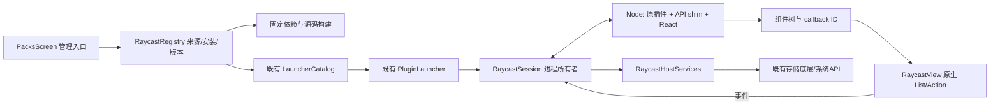

# AnyWhere 支持 Raycast 扩展：逐文件实施计划

日期：2026-09-28

仓库：`/Users/evan/IdeaProjects/AnyWhere`

基线：`f08f8f92a82278b30edb1d998087681723dcecb9`，**包含当前未提交修改**。

源码清单指纹：`566c23adc6b975c6c210bb19caf0fc33810adf09da77ca5aadad54bd5993f9d5`。
状态：**仅完成源码调查和实施计划；兼容运行时尚未实现、构建或实测。**

## 1. 结论与范围

可以做，推荐在 AnyWhere 中增加“Raycast 源码兼容”入口：公开插件的 TS/TSX 业务源码保持不变，由 AnyWhere 构建和运行，宿主实现它需要的 `@raycast/api`。现有搜索和插件管理入口足以承接；现有 HTML 插件本身不需要迁移。

这里是**新增兼容运行时**，不是 Swift 到 TypeScript 的语言迁移。不能把 `package.json` 换成 AnyWhere manifest 就宣称兼容。首批交付限定为 macOS 搜索入口中的 no-view 命令与基础 List/ActionPanel 插件，以三个真实插件的指定命令验收。默认采用用户提出的“支持 Raycast 插件”的源码原样运行方向；如果目标是另几个特定插件，应先替换验收样本再调整 API 范围。

本计划只新增必要模块，预计涉及现有 159 个源码/配置/测试数据文件中的 **10 个文件**，另有本地化和说明文档变更。Finder、native manifest、已有 HTML CSP、脚本任务、摘要、通知、跨包工作流都保留。首期不接 Raycast 私有商店、账号、云服务，不承诺所有插件或整个 API 版本完全兼容。

按下面的阶段估计，首批可分发版本约 **218 小时，单人约 5–8 个工作周**；这是未知量较大的工程估算，不是交付承诺。第一个验证点只需约 20 小时，用原始 Base64 命令确认构建与运行方案，再决定是否继续增加 UI 支持。全量生态兼容没有可信的固定工期，不能从三款插件通过外推。

## 2. 已验证的技术事实

| 事实 | 当前证据 | 对实现的影响 |
|---|---|---|
| AnyWhere native 包是 script 或 HTML UI | [PackManifest.swift](/Users/evan/IdeaProjects/AnyWhere/Core/Sources/AnyWhereCore/PackManifest.swift:130)、[PluginSession.swift](/Users/evan/IdeaProjects/AnyWhere/App/Plugins/PluginSession.swift:34) | 不能将 TSX 当 HTML，也不修改已有 manifest/CSP |
| 现有任务固定 zsh、stdin 关闭、结束清理 | [PluginTask.swift](/Users/evan/IdeaProjects/AnyWhere/Core/Sources/AnyWhereCore/PluginTask.swift:95) | 新 Node 会话单独拥有进程和通信 |
| 搜索已有多 target | [LauncherCatalog.swift](/Users/evan/IdeaProjects/AnyWhere/App/Plugins/LauncherCatalog.swift)、[PackManager.swift](/Users/evan/IdeaProjects/AnyWhere/App/Managers/PackManager.swift:316) | 新增一个 raycast target，在现有聚合点合入 |
| 原包身份以仓库为单位 | [PackManager.swift](/Users/evan/IdeaProjects/AnyWhere/App/Managers/PackManager.swift) | Raycast monorepo 必须包含 extension 子目录身份 |
| 现有配置按 action 保存，键要求大写、值为字符串 | [PackSettings.swift](/Users/evan/IdeaProjects/AnyWhere/Core/Sources/AnyWhereCore/PackSettings.swift:42) | Raycast 配置模型独立，保留键名、类型、extension/command 作用域 |
| 原子存储、稳定 ID、资源校验可复用 | [PluginDataStore.swift](/Users/evan/IdeaProjects/AnyWhere/Core/Sources/AnyWhereCore/PluginDataStore.swift)、[PluginContract.swift](/Users/evan/IdeaProjects/AnyWhere/Core/Sources/AnyWhereCore/PluginContract.swift)、[PluginResourceResolver.swift](/Users/evan/IdeaProjects/AnyWhere/Core/Sources/AnyWhereCore/PluginResourceResolver.swift) | 复用底层，新的安装/数据目录；首期无需新增通用插件框架 |
| 设置页面已容纳插件管理 | [PacksScreen.swift](/Users/evan/IdeaProjects/AnyWhere/App/UI/PacksScreen.swift:13) | 只加管理 sheet 入口；不新建 SettingsTab |
| 现有快捷键控件绑定 native action | [ShortcutsScreen.swift](/Users/evan/IdeaProjects/AnyWhere/App/UI/ShortcutsScreen.swift:181) | 首期使用已有全局搜索快捷键；不伪造 MenuAction 借用单命令热键 |

官方运行模型使用 Node 和宿主 RPC；扩展使用 React 组件。Node 子进程/worker 不自动提供文件、网络、进程权限沙箱。[运行与安全模型](https://developers.raycast.com/information/security) · [UI API](https://developers.raycast.com/api-reference/user-interface)

本次读取 npm 固定版本 metadata 和 tarball 后确认：`@raycast/api@2.5.2` 包含类型、CLI 和构建工具，不能提供可独立使用的 Raycast 主应用宿主；仅安装此包不够。其依赖基线是 React 19.0.0、Node >=22.22.2。`@raycast/utils@2.3.2` 有可运行 JS，但使用多种宿主 API 和 Node builtins；需要核对传递调用链。[API metadata](https://registry.npmjs.org/@raycast/api/2.5.2) · [utils metadata](https://registry.npmjs.org/@raycast/utils/2.3.2)

现有兼容实现 Vicinae 证明此方向可行，但其 compat 包主要重导出自己的 API，实际依赖 global client、React reconciler、生成协议与 Qt/C++ 宿主服务。不能作为一个 npm 依赖直接接入 Swift 宿主。根 LICENSE、TS 包 metadata、server 子目录的许可文本也不同，本计划只参考公开契约和行为，**不复制其代码**；如以后决定复制，需先查明所用文件的授权范围。[compat](https://github.com/vicinaehq/vicinae/tree/8d80bf6011de177a19f1b5f1243ec505f441b7e7/src/typescript/raycast-api-compat) · [runtime](https://github.com/vicinaehq/vicinae/tree/8d80bf6011de177a19f1b5f1243ec505f441b7e7/src/typescript/extension-manager) · [宿主服务](https://github.com/vicinaehq/vicinae/blob/8d80bf6011de177a19f1b5f1243ec505f441b7e7/src/server/src/extension/extension-command-runtime.cpp) · [许可](https://github.com/vicinaehq/vicinae/blob/8d80bf6011de177a19f1b5f1243ec505f441b7e7/LICENSE)

## 3. 兼容目标与验收插件

扩展源码固定到 `raycast/extensions@763301ae07cad6dcfed033e213fea1ccdd91fdfd`。导入单位是该仓库下的一个 extension 子目录。保留 package/source/assets/LICENSE；完整依赖树需要另生成或采纳经验证的精确 lock，不使用浮动版本作为验收依据。

| 插件 | 本期指定命令 | 必要契约 | 不外推的部分 |
|---|---|---|---|
| [Base64](https://github.com/raycast/extensions/tree/763301ae07cad6dcfed033e213fea1ccdd91fdfd/extensions/base64) | encode、decode；后续 index | Clipboard、Toast、closeMainWindow；List/Action、React hooks、utils.usePromise | 不是任意 utils hook 都支持 |
| [UUID Generator](https://github.com/raycast/extensions/tree/763301ae07cad6dcfed033e213fea1ccdd91fdfd/extensions/uuid-generator) | generate 的 V4 路径、viewHistory | 同步偏好、复制/粘贴、HUD、LocalStorage、List、确认删除 | 其他 ID 类型与所有设置组合需另验 |
| [Lorem Ipsum](https://github.com/raycast/extensions/tree/763301ae07cad6dcfed033e213fea1ccdd91fdfd/extensions/lorem-ipsum) | paragraphs、sentences、words | arguments、偏好、复制/粘贴、Toast 重载 | ai-generate 明确不支持 |

判断“原样运行”：**上游业务源码 hash 不变**；宿主生成的编译结果、依赖 lock、API alias 和构建设置可以不同，并记录这些差异。若某命令需要修改业务源码，应标为“适配版”，不能继续计为原样兼容。

| 能力 | 首批范围 | 后续触发条件 |
|---|---|---|
| TS/TSX、Node 标准能力、普通 JS 依赖 | 固定 runtime + esbuild + 单一 React 实例；支持审核过的依赖闭包 | 原生 addon/helper 单独验证后才加入 |
| manifest / commands / arguments | view、no-view；命令级不支持状态；按原字段收集参数 | menu-bar、interval/background 有具体样本后扩展 |
| preferences / environment | 模块加载前注入；原始键和 typed values；扩展与命令作用域 | appPicker/file/directory 等类型按实际样本扩展 |
| LocalStorage | 首批命令用到的 get/set/remove，扩展共享、安装间隔离 | getAllItems 等有命令需求再补；5 MiB 底层限制须记录 |
| UI | List/Item/Section/EmptyView、ActionPanel/Section、必要 Action、Icon/Color 子集 | Detail、Form、Grid、navigation、refs、drafts 每类用真实插件验收 |
| 系统服务 | text Clipboard read/copy/paste、open browser、HUD/Toast、confirmAlert | selected text/files、应用控制、窗口管理按权限与语义分别验证 |
| utils | 仅 Base64 所用 usePromise 及其真实依赖 | useFetch/useSQL/useCachedPromise 等逐项扩充 |
| 跨命令 launchCommand | 首批不支持 | 先建立 source/command 生命周期，再验跨扩展权限与返回语义 |
| OAuth / AI / Cloud | 明确不支持；不假报 canAccess | AnyWhere 自有 provider/服务接入后独立规划 |
| 安装来源 | 本地源码目录，随后固定 repo+subdir+commit | 不依赖未公开商店协议，不搬 Raycast 账号数据 |
| 独立窗口/单命令热键/Finder入口 | 首批不新增 | 首批原样插件通过后，按用户需求接入现有能力 |

偏好读取 `getPreferenceValues()` 是同步契约，不能偷偷改为 Promise；`environment` 也须在 import 执行前就绪。密码偏好交给被信任的插件是 Raycast 契约的一部分，不能因此放宽现有 AnyWhere HTML 插件的密码访问保护。[偏好 API](https://developers.raycast.com/api-reference/preferences)

OAuth 的 provider、client、redirect、token 生命周期不是普通函数别名；Raycast 的预配置 OAuthService 使用其应用和服务端。AI 也属于宿主服务，具有具体流式/权限语义。后续如接入需使用 AnyWhere 自己的授权与服务配置。[OAuthService](https://developers.raycast.com/utilities/oauth/oauthservice) · [OAuth](https://developers.raycast.com/api-reference/oauth) · [AI](https://developers.raycast.com/api-reference/ai)

## 4. 最小架构与数据边界

- **安装**：独立 registry，不把 Raycast 当 `PackManifest`。持久安装 ID 由宿主生成/确认；远端身份含规范化 repo 和 extension subdir，revision 单独记录。command UUID 由安装 ID + command name 派生；重启/更新不换 ID，同名不同来源不碰撞。
- **构建**：静态预览→用户信任/接受→私有临时目录解析并锁定依赖→构建→校验产物与登记→显式启用。预览阶段不执行 npm scripts。默认禁止 lifecycle scripts，忽略 scripts 后仍需额外步骤的 native 依赖明确不支持。使用自有 bundler 配置，不执行插件自定义构建脚本。
- **状态**：源码快照、依赖锁、bundle hash、shim版本一起决定可运行制品。更新不沿用旧 bundle；失败保留旧版本。升级的新命令或新增所需能力重新审阅。
- **Node**：首期每个活动命令一个受宿主管理的进程，简单、可清理；不先造常驻进程池。插件可使用被支持的 Node 功能，但这是**用户信任代码执行**，不是 OS 沙箱。
- **通信**：Swift Foundation Process 的受控管道/专用通道；显式 frame 上限、request ID、session ID、协议版本。日志不能写入协议通道。对方传来的 extensionID 不决定文件路径，宿主按已绑定会话选择数据目录。
- **渲染**：React 与 hooks 留在 Node，用匹配版本的 reconciler 输出组件树。闭包保留在 Node，以 callback ID 回传事件；unmount 回收回调。首期原生 SwiftUI 列表/动作，不重建完整浏览器 UI，更不改变现有 WKWebView。
- **配置**：启动前构建 typed preference 快照，正确合并扩展/命令定义、默认值与用户值。Secret 使用现有 PackSecretStore 底层，但此加密存储不隔离同用户任意 Node fs；不宣称 Keychain 或插件沙箱。
- **生命周期**：沿用“失焦隐藏”与“返回/关闭结束”的区分。禁用/更新/卸载/退出先清理其进程和挂起请求；确认停止后才换代码或清数据。首期不承诺任意插件主动 daemonize 的后台任务可被完全约束，检测到这类依赖列不支持。
- **失败**：unknown API/mode/version/type 显式报不支持。静态导入扫描只是预筛，动态调用仍要校验；不能靠“返回空对象/假成功”通过插件。

## 5. 全仓库摄入、依赖和风险模型

### 5.1 摄入范围

扫描 **159 个源码/配置/测试数据文件，21,672 行**；另检查 3 份本地化资源结构和签名配置模板。所有 <1000 行源码由本任务或摄入代理全文读取；`DesignSystem.swift` 1003 行只读 1–500、904–1003 及声明，**501–903 未全文阅读**；不计划修改它。1922 行 plist 为测试 fixture，按结构和消费者总结，不算已逐行审查。

排除：`.worktrees` 的重复 checkout、build/.build、node_modules、生成工程、图片/二进制、lock/生成bundle、本机签名配置秘密、.codex/.superpowers 运行数据及无关 Markdown。xlog-decoder 是 Mach-O 二进制，不误算为源码。当前生产源码和目标配置的逐文件 SHA、imports、引用候选、层级、变更频次、阅读状态、风险/工时都在 [migration-plan.json](/Users/evan/IdeaProjects/AnyWhere/docs/research/raycast-compatibility/migration-plan.json) 中。

| 类型 | 文件数 | 行数 |
|---|---:|---:|
| .yml | 3 | 219 |
| .swift | 115 | 18446 |
| .plist | 4 | 1997 |
| .sh | 8 | 234 |
| .entitlements | 1 | 8 |
| Makefile | 1 | 27 |
| .ts | 1 | 97 |
| .zsh | 9 | 113 |
| .json | 5 | 128 |
| .html | 7 | 138 |
| .css | 2 | 49 |
| .js | 3 | 216 |

| 文件行数 | 文件数 |
|---|---:|
| <50 | 59 |
| 50–150 | 64 |
| 151–300 | 23 |
| 301–500 | 5 |
| 501+ | 8 |

| 目录 | 作用与迁移边界 |
|---|---|
| Core/Sources | Foundation、配置/存储/协议；新增3个Raycast文件，不改native schema |
| Core/Tests | 对新增契约补最小测试；原26个Swift测试文件保留 |
| App/Plugins、Managers | 搜索聚合与执行入口；新的运行时放App/Raycast |
| App/UI | 仅PacksScreen增加入口；其余保留 |
| AppTests | 新集成测试，LauncherTests补混合入口与生命周期 |
| FinderExtension、App/PresetScripts | 不改；不扩展Finder或预设行为 |
| examples、docs/sdk | 全部保留，作为native契约资料 |
| Runtime/raycast | 新增Node shim/构建/renderer及其测试 |
| project.yml、scripts、.github | 运行时资源、CI、签名和分发 |

### 5.2 依赖图的精度与环

Swift 同 module 文件没有相互 import。本次提取全部 Swift module imports，并用类型标识符引用生成文件级候选邻接表；JS/HTML 本地资源引用单独记录。**候选图不是编译器/CodeGraph 调用图**，可能包含注释或同名类型误边。它只用于查漏和 centrality 估算；关键生命周期和接入点已人工沿源码确认。

构建 module DAG 是 `AnyWhereCore → AnyWhere/FinderExtension → AppTests`；Foundation/AppKit 等平台 module 位于底层，没有发现 package 层依赖环。候选文件图有三组 SCC，详见 JSON：
1. Core models/manifest/settings/icon/path 等 9 文件互引；
2. PluginPreferencesStore 与 Core PluginServices；
3. AppState/PackManager/PluginLauncher 及相关 App/UI 的 24 文件互引候选。

人工确认的运行耦合包括 `AppState ↔ PackManager`、`PackManager ↔ PluginLauncherController`、`PluginServices ↔ PluginSession`。这些不是新迁移必须先拆的编译环；native代码仍在同一 target。**不为本任务重构整组 SCC**。P5 将新增 target、聚合和路由作为一次原子改动；下层 P1–P4 已可独立测试。

候选 centrality 最高的是 Models(39)、PluginContract(29)、PackManifest(25)、PluginPreferencesStore(23)、Core PluginServices(22)、PackManager(21)。前五项不需要为兼容层改写；PackManager 仅新增聚合接点。这样控制影响面，比迁移整套插件模型更小。

新工作依赖按 P1→P2→…→P10 拓扑排序，阶段内部按表格顺序落地；同一文件可以逐阶段扩展，前一阶段不能引用尚未存在的类型。P5 只启动 no-view，P6 才接入 RaycastView。测试随能力交付，不统一拖到最后。

### 5.3 外部依赖

| 依赖 | 分类 | 本计划处理 |
|---|---|---|
| Foundation/AppKit/SwiftUI/WebKit/CryptoKit 等 Apple modules | 保留 | macOS 13，现有Swift 5.9；不加Swift框架 |
| AnyWhereCore / Sparkle >=2.6.0 配置 | 保留 | 新Swift源文件自动入target；更新器不改职责 |
| Node | 新增 | 按架构固定受校验版本、许可、签名；SDK当前最低要求 >=22.22.2，实施时选安全修订版 |
| React 19.0.0 / reconciler 0.31.0 / scheduler | 新增 | 作为起始兼容组合；锁定实际版本，避免双React；以运行验收为准 |
| esbuild 0.28.x | 新增构建工具 | 选定精确patch并锁住；API alias；不执行上游脚本 |
| @raycast/api 2.5.2 | 需要兼容出口 | 类型/契约参考；不假装有可复用的官方host |
| @raycast/utils 2.3.2 | 有条件复用 | 普通JS逻辑保留，只承诺验收过的hooks/API闭包 |
| uuid/lorem-ipsum/js-base64/typeid-js/ulidx 等 | 样本依赖 | 固定解析树、license、hash；未使用路径不推断支持 |
| native addons / 外部可执行helper | 暂不支持 | 需要另验构建/架构/签名/权限 |
| Vicinae | 仅参考 | 不纳入运行依赖、不引入Qt/CMake协议栈 |

[reconciler 0.31.0 metadata](https://registry.npmjs.org/react-reconciler/0.31.0) 的 peer 是 React ^19.0.0。版本表是本次核查基线，不代表已经完成安装验证。新增的 lock、上游测试源码/许可证和bundle属于生成/固定输入，随实施阶段保存，不手工臆造依赖锁。

风险分数 1–5：**0.25×复杂度 + 0.30×中心性 + 0.15×变更频度 + 0.15×测试缺口 + 0.15×外部耦合**。当前文件使用行数分段、候选入度、最近20次提交计数、同名测试存在性、平台imports作为可复现代理；不是实测圈复杂度、覆盖率或出错概率。新增文件的分数为保守人工评估。P0 的分数描述现有文件特征，**不意味着要修改它**。

| 主要风险 | 概率/影响判断 | 控制与验收 |
|---|---|---|
| 直接API看似齐全，utils传递依赖仍失败 | 高/高 | 固定真实入口完整bundle并执行，不能只grep顶层import |
| hooks/事件/焦点与动作语义不一致 | 高/高 | P6–P7真实UI事件验收，callback卸载与重绘测试 |
| 依赖安装先于信任，或Node被误称沙箱 | 中/高 | 预览无执行；信任后构建；明确Node用户权限模型 |
| update/uninstall与运行中写入竞态 | 中/高 | 停止屏障、快照替换、失败回滚、保留数据 |
| Node架构/JIT/签名/最低OS不兼容 | 中/高 | P9真实制品验证；不静默放宽整个App签名/权限 |
| 当前dirty文件与其他工作冲突 | 高/中 | 按当前hash继续；实施前重读变化；只修改计划接点 |
| 误把官方OAuth/AI服务当本机能力 | 高/高 | 首批明确不支持；另注册provider和验证服务契约 |

## 6. 实施阶段（均尚未执行）

每阶段约2–3个8小时工作日，按能力串行推进。重复出现的文件表示增量扩展，不是重复创建或重复计算同一任务。这里按一人实施估算；当前各阶段共享runtime/API/launcher和验收环境，不满足独立写集条件，因此**不安排并行实施代理**。

### P1 · 独立运行可行性

依赖：无，开发工具独立验证。净工作 16h；含检查与缓冲 20.1h。

| 顺序 | 文件 | 净工时 | 具体变化 |
|---|---|---:|---|
| 1 | `Runtime/raycast/package.json` | 2h | 固定 Node/React/esbuild 开发依赖和 scripts；生成 lock，不安装官方 host |
| 2 | `Runtime/raycast/build.mjs` | 5h | 将源码 TS/TSX bundle 到隔离目录；alias @raycast/api；单 React 实例；不执行插件 scripts |
| 3 | `Runtime/raycast/worker.mjs` | 4h | 启动指定 no-view 命令，预置 environment；stdout 日志与协议分离 |
| 4 | `Runtime/raycast/api.tsx` | 3h | 首个 no-view 命令所需 API shim，未知 API 显式错误 |
| 5 | `Runtime/raycast/tests/runtime.test.mjs` | 2h | 固定 Base64 encode/decode 原源码 smoke，UTF8/失败与退出 |

验收：固定 Base64 encode/decode 源码不修改，依赖锁可重建；CLI 测试宿主收到正确 API 请求，编码结果一致。这里只证明 Node/构建/API 映射，不宣称已在 App 运行。若必须改插件业务源码才能通过，先修兼容契约或记录该命令不支持。

回滚：本阶段新增文件与测试可独立撤销，尚未启用用户入口。

### P2 · Swift 与 Node 会话

依赖：P1。净工作 18h；含检查与缓冲 22.5h。

| 顺序 | 文件 | 净工时 | 具体变化 |
|---|---|---:|---|
| 1 | `Core/Sources/AnyWhereCore/RaycastProtocol.swift` | 3h | 有界版本化消息、会话 ID、请求/响应与事件类型 |
| 2 | `App/Raycast/RaycastSession.swift` | 9h | Process 生命周期、私有 IPC 管道、取消/超时/崩溃/后代进程回收 |
| 3 | `AppTests/RaycastTests.swift` | 6h | 协议坏包/日志混入/进程退出/挂起请求与取消 |

验收：Swift 启动并完成握手；坏消息、超大消息、stderr 洪泛、崩溃、取消与挂起请求有确定结局。插件日志不能损坏协议；退出后无本阶段所启动的遗留进程。

回滚：本阶段新增文件与测试可独立撤销，尚未启用用户入口。

### P3 · 清单与本地安装

依赖：P2。净工作 18h；含检查与缓冲 22.5h。

| 顺序 | 文件 | 净工时 | 具体变化 |
|---|---|---:|---|
| 1 | `Core/Sources/AnyWhereCore/RaycastManifest.swift` | 5h | Raycast package.json/commands/preferences/arguments；路径、mode、平台校验 |
| 2 | `App/Raycast/RaycastRegistry.swift` | 8h | 本地来源快照、安装 ID、默认禁用、bundle hash；先审阅后构建 |
| 3 | `Core/Tests/AnyWhereCoreTests/RaycastContractTests.swift` | 5h | 清单/identity/path/错误分类与快照验证 |

验收：本地目录只读预览不执行；用户接受后才在私有临时目录解析依赖/构建。重复包、路径逃逸、未知 mode 被拒绝；失败不出现在已安装列表，取消保留原状态。

回滚：本阶段新增文件与测试可独立撤销，尚未启用用户入口。

### P4 · 配置和基础宿主 API

依赖：P3。净工作 18h；含检查与缓冲 22.5h。

| 顺序 | 文件 | 净工时 | 具体变化 |
|---|---|---:|---|
| 1 | `Core/Sources/AnyWhereCore/RaycastPreferencesStore.swift` | 5h | 原始键/typed value/extension与command作用域；secret存储；同步启动快照 |
| 2 | `App/Raycast/RaycastHostServices.swift` | 6h | clipboard/open/Toast/HUD、LocalStorage使用现有原子存储；前台应用上下文 |
| 3 | `Runtime/raycast/api.tsx` | 3h | 同步 preferences/environment，异步 storage/clipboard，Toast重载 |
| 4 | `Core/Tests/AnyWhereCoreTests/RaycastContractTests.swift` | 2h | typed prefs/默认值/作用域/秘密不落普通JSON |
| 5 | `AppTests/RaycastTests.swift` | 2h | UUID历史持久化及clipboard回桥契约 |

验收：源码不改的 UUID generate/Lorem 普通命令通过异步服务桥；同扩展命令共享 LocalStorage，不同安装不串数据。密码不写普通JSON或日志；clipboard paste实际前台焦点及权限拒绝留到桌面验收。

回滚：本阶段新增文件与测试可独立撤销，尚未启用用户入口。

### P5 · 现有入口接通

依赖：P4。净工作 18h；含检查与缓冲 22.5h。

| 顺序 | 文件 | 净工时 | 具体变化 |
|---|---|---:|---|
| 1 | `App/Plugins/LauncherCatalog.swift` | 1h | 新增显式 raycast command target/搜索投影 |
| 2 | `App/Managers/PackManager.swift` | 1h | 仅在 catalog 聚合点合入兼容命令；不改 native manifest/安装记录 |
| 3 | `App/Plugins/PluginLauncher.swift` | 6h | 新 target 分派、arguments 收集、Raycast 会话状态和 focus/close |
| 4 | `App/AppDelegate.swift` | 1h | 启动读取 registry；应用退出关闭全部 Raycast 进程 |
| 5 | `App/UI/PacksScreen.swift` | 1h | 复用插件页加一个 Raycast 管理 sheet 入口 |
| 6 | `App/Raycast/RaycastExtensionsView.swift` | 6h | 来源审阅/安装/启停/错误/卸载与 typed preferences；复用系统控件 |
| 7 | `App/Localizable.xcstrings` | 1h | 导入/运行/兼容状态与错误文案 |
| 8 | `AppTests/LauncherTests.swift` | 1h | 混合搜索、独立身份、no-view路由回归 |

验收：现有插件页可以审阅导入、显式启用；搜索能启动 no-view，参数/必填偏好可补齐；旧 HTML、脚本、快捷链接结果仍可打开。view 命令在 P6/P7 达标前显示不支持，不显示空白成功页。

回滚：移除或关闭 Raycast 入口，停止其进程，保留专属安装/数据目录；native 包与 Finder schema 未迁移。

### P6 · React List 渲染

依赖：P5。净工作 18h；含检查与缓冲 22.5h。

| 顺序 | 文件 | 净工时 | 具体变化 |
|---|---|---:|---|
| 1 | `Runtime/raycast/renderer.ts` | 7.5h | React reconciler、稳定节点/回调 ID、增量重绘、unmount清理 |
| 2 | `Runtime/raycast/api.tsx` | 4h | List/Item/Section/EmptyView、基础 Icon/Color、loading/search props |
| 3 | `App/Raycast/RaycastView.swift` | 5h | 原生 List 与搜索/选择/加载/空态，模型呈现及事件回传 |
| 4 | `Runtime/raycast/tests/runtime.test.mjs` | 1h | hooks更新与卸载后无事件 |
| 5 | `App/Plugins/PluginLauncher.swift` | 0.5h | 将已存在的 Raycast 会话接到原生 RaycastView；不引入通用session接口 |

验收：React useState/useEffect 更新在原生 List 中可见；列表选择稳定，搜索回传、空态、loading、卸载清理正确。独立测试组件不替代 P7 真插件验收。

回滚：移除或关闭 Raycast 入口，停止其进程，保留专属安装/数据目录；native 包与 Finder schema 未迁移。

### P7 · 动作和真实 UI 插件

依赖：P6。净工作 18h；含检查与缓冲 22.5h。

| 顺序 | 文件 | 净工时 | 具体变化 |
|---|---|---:|---|
| 1 | `Runtime/raycast/api.tsx` | 5h | ActionPanel/Section/Action 与复制/粘贴/浏览器动作；confirmAlert；utils传递API |
| 2 | `App/Raycast/RaycastView.swift` | 5h | 动作顺序、默认回车、键盘、确认取消、错误与Toast更新 |
| 3 | `Runtime/raycast/worker.mjs` | 2h | view/no-view加载模式与usePromise依赖闭包 |
| 4 | `Runtime/raycast/tests/runtime.test.mjs` | 3h | UUID viewHistory/Base64 index 原源码，usePromise重渲染与unsupported |
| 5 | `AppTests/LauncherTests.swift` | 3h | 真实UI交互、Esc/失焦保留/重开/取消与原生WebView边界回归 |

验收：UUID viewHistory、Base64 index 使用固定原源码通过；usePromise 的传递依赖也通过。回车默认动作、复制、删除确认/取消、URL动作、搜索异步更新、失焦重开均有可复现证据。

回滚：移除或关闭 Raycast 入口，停止其进程，保留专属安装/数据目录；native 包与 Finder schema 未迁移。

### P8 · 固定来源、更新与卸载

依赖：P7。净工作 18h；含检查与缓冲 22.5h。

| 顺序 | 文件 | 净工时 | 具体变化 |
|---|---|---:|---|
| 1 | `App/Raycast/RaycastRegistry.swift` | 8h | repo+subdir固定commit导入、依赖锁与hash、原子替换/回滚；更新重新审阅 |
| 2 | `App/Raycast/RaycastSession.swift` | 3h | 禁用/更新/卸载停止屏障，挂起事务失败可恢复 |
| 3 | `App/Raycast/RaycastExtensionsView.swift` | 3h | 来源revision/能力差异、更新确认、保留或清除数据 |
| 4 | `AppTests/RaycastTests.swift` | 4h | 重复安装/恶意路径/依赖scripts拒绝/更新失败/无孤儿进程 |

验收：repo+子目录定位不串包；新版本代码与 lock/hash可追溯；所有旧会话先退出再换目录/清数据，更新中断恢复旧版本，清除数据明确执行且不波及native包。

回滚：恢复上一个安装快照与登记记录，保留数据；首期禁止不可逆数据迁移。

### P9 · 运行时分发与 CI

依赖：P8。净工作 18h；含检查与缓冲 22.5h。

| 顺序 | 文件 | 净工时 | 具体变化 |
|---|---|---:|---|
| 1 | `project.yml` | 3h | 嵌入固定runtime资源及按架构Node helper；保持macOS13目标 |
| 2 | `scripts/bundle-raycast-runtime.sh` | 5h | 校验Node来源checksum、可重复bundle、依赖许可清单；开发与发布共同入口 |
| 3 | `scripts/release.sh` | 3h | 嵌套helper签名/hardened runtime并纳入归档、公证检查 |
| 4 | `.github/workflows/ci.yml` | 3h | Node/shim测试与隔离样本；保留现有Core/预设验证 |
| 5 | `.github/workflows/release.yml` | 2h | 发布前调用固定runtime打包步骤；制品一致性 |
| 6 | `Runtime/raycast/package.json` | 2h | 确定发布锁和支持版本组合；新增依赖许可证核对 |

验收：受支持架构的 Node 与资源随App交付，运行不依赖用户npm/Homebrew；签名、公证、Gatekeeper和macOS最低版本实测。CI只验证签名关闭构建不足以通过这一关。

回滚：恢复上一宿主制品；兼容包停止运行但数据保留，禁止静默改用系统未知 Node。

### P10 · 发布验收与兼容说明

依赖：P9。净工作 14h；含检查与缓冲 17.7h。

| 顺序 | 文件 | 净工时 | 具体变化 |
|---|---|---:|---|
| 1 | `AppTests/RaycastTests.swift` | 5h | 冻结树一次桌面流程/权限拒绝/更新与卸载回归；性能基线 |
| 2 | `Runtime/raycast/tests/runtime.test.mjs` | 3h | 最终固定源码验收集、差异清单及失败输出 |
| 3 | `docs/raycast-compatibility.zh.md` | 4h | 按命令公布通过/不支持/未验证，来源和API版本及回滚说明 |
| 4 | `README.zh.md` | 1h | 新增入口与已验收范围 |
| 5 | `README.md` | 1h | 对应英文说明 |

验收：范围冻结后一次最终宿主验收：三个候选指定命令、权限拒绝、安装更新卸载、旧PluginSession CSP与launcher回归。记录树hash/OS/CPU/runtime版本、结果和仍不支持的命令；没有通过的项不能标为兼容。

回滚：对未通过项回退支持状态；撤销入口不会删用户数据。

## 7. 逐文件清单

P0 = 无需迁移，0小时指没有实施改动，不含本次调查时间。各文件的模式/类型、精确module imports、候选依赖与被依赖、风险分项、阅读状态和具体变更在 JSON 中；P1–P10 的改动与测试目标见上表。

### 7.1 已有源码、配置和fixture

| 文件 | 行数 | 层级 | 阶段 | 风险分 | 净工时h |
|---|---:|---|---|---:|---:|
| `.github/workflows/ci.yml` | 37 | config | P9 | 1.45 | 3 |
| `.github/workflows/release.yml` | 82 | config | P9 | 1.70 | 2 |
| `App/ActionDispatcher.swift` | 31 | entry | P0 保留 | 2.05 | 0 |
| `App/ActionListener.swift` | 18 | entry | P0 保留 | 1.75 | 0 |
| `App/ActionRunner.swift` | 145 | entry | P0 保留 | 2.75 | 0 |
| `App/AnyWhereApp.swift` | 57 | entry | P0 保留 | 2.45 | 0 |
| `App/AppDelegate.swift` | 42 | entry | P5 | 2.50 | 1 |
| `App/AppDetect.swift` | 71 | entry | P0 保留 | 2.30 | 0 |
| `App/AppState.swift` | 212 | entry | P0 保留 | 3.15 | 0 |
| `App/ExecutionLog.swift` | 49 | entry | P0 保留 | 1.75 | 0 |
| `App/FinderDirectory.swift` | 28 | entry | P0 保留 | 2.20 | 0 |
| `App/Info.plist` | 34 | config | P0 保留 | 1.60 | 0 |
| `App/Managers/CapabilityProbe.swift` | 90 | services | P0 保留 | 2.00 | 0 |
| `App/Managers/ExtensionManager.swift` | 67 | services | P0 保留 | 2.30 | 0 |
| `App/Managers/OpenWithCleaner.swift` | 74 | services | P0 保留 | 2.30 | 0 |
| `App/Managers/PackConfiguration.swift` | 10 | services | P0 保留 | 2.05 | 0 |
| `App/Managers/PackDiscovery.swift` | 129 | services | P0 保留 | 2.60 | 0 |
| `App/Managers/PackManager.swift` | 861 | services | P5 | 4.25 | 1 |
| `App/Managers/ServicesManager.swift` | 182 | services | P0 保留 | 2.25 | 0 |
| `App/Notifier.swift` | 16 | entry | P0 保留 | 1.75 | 0 |
| `App/Permissions.swift` | 77 | entry | P0 保留 | 2.45 | 0 |
| `App/Plugins/LauncherCatalog.swift` | 71 | services | P5 | 2.60 | 1 |
| `App/Plugins/LauncherWorkflowRun.swift` | 51 | services | P0 保留 | 2.15 | 0 |
| `App/Plugins/PluginDocuments.swift` | 110 | services | P0 保留 | 2.45 | 0 |
| `App/Plugins/PluginLauncher.swift` | 871 | services | P5/P6 | 4.40 | 6.5 |
| `App/Plugins/PluginReminderPanel.swift` | 211 | services | P0 保留 | 2.55 | 0 |
| `App/Plugins/PluginServices.swift` | 260 | services | P0 保留 | 3.00 | 0 |
| `App/Plugins/PluginSession.swift` | 401 | services | P0 保留 | 3.25 | 0 |
| `App/Plugins/PluginSummaryHost.swift` | 157 | services | P0 保留 | 2.70 | 0 |
| `App/Plugins/ToolWorkspaceController.swift` | 118 | services | P0 保留 | 2.60 | 0 |
| `App/PresetScripts/copy-path.sh` | 4 | config | P0 保留 | 1.45 | 0 |
| `App/PresetScripts/cut.sh` | 4 | config | P0 保留 | 1.45 | 0 |
| `App/PresetScripts/new-file.sh` | 17 | config | P0 保留 | 1.45 | 0 |
| `App/PresetScripts/open-enclosing.sh` | 25 | config | P0 保留 | 1.45 | 0 |
| `App/PresetScripts/open-parent.sh` | 29 | config | P0 保留 | 1.45 | 0 |
| `App/PresetScripts/paste.sh` | 27 | config | P0 保留 | 1.45 | 0 |
| `App/PresetSeeder.swift` | 164 | entry | P0 保留 | 2.25 | 0 |
| `App/UI/DeclutterSheet.swift` | 203 | components | P0 保留 | 2.55 | 0 |
| `App/UI/DesignSystem.swift` | 1003 | components | P0 保留 | 3.65 | 0 |
| `App/UI/DiscoverPacksSheet.swift` | 167 | components | P0 保留 | 3.00 | 0 |
| `App/UI/ExecutionLogView.swift` | 95 | components | P0 保留 | 2.30 | 0 |
| `App/UI/GeneralTab.swift` | 278 | components | P0 保留 | 2.70 | 0 |
| `App/UI/IconPicker.swift` | 143 | components | P0 保留 | 2.30 | 0 |
| `App/UI/IconStore.swift` | 124 | components | P0 保留 | 2.60 | 0 |
| `App/UI/MenuHubPanels.swift` | 985 | components | P0 保留 | 3.50 | 0 |
| `App/UI/MenuHubScreen.swift` | 810 | components | P0 保留 | 3.35 | 0 |
| `App/UI/OnboardingView.swift` | 376 | components | P0 保留 | 2.95 | 0 |
| `App/UI/OpenWithTab.swift` | 171 | components | P0 保留 | 2.25 | 0 |
| `App/UI/PackConfigurationForm.swift` | 102 | components | P0 保留 | 2.30 | 0 |
| `App/UI/PackImportSheet.swift` | 915 | components | P0 保留 | 3.35 | 0 |
| `App/UI/PacksScreen.swift` | 448 | components | P5 | 3.25 | 1 |
| `App/UI/PluginIconView.swift` | 49 | components | P0 保留 | 2.05 | 0 |
| `App/UI/PluginSettingsView.swift` | 78 | components | P0 保留 | 2.30 | 0 |
| `App/UI/SettingsWindow.swift` | 60 | components | P0 保留 | 2.60 | 0 |
| `App/UI/ShortcutsScreen.swift` | 260 | components | P0 保留 | 3.00 | 0 |
| `AppTests/BazaarTests.swift` | 266 | tests | P0 保留 | 2.10 | 0 |
| `AppTests/LauncherTests.swift` | 467 | tests | P5/P7 | 2.50 | 4 |
| `AppTests/OfficialPluginTests.swift` | 659 | tests | P0 保留 | 2.50 | 0 |
| `AppTests/PluginIconTests.swift` | 71 | tests | P0 保留 | 1.55 | 0 |
| `AppTests/PluginSessionTests.swift` | 65 | tests | P0 保留 | 2.00 | 0 |
| `AppTests/PluginSummaryTests.swift` | 245 | tests | P0 保留 | 1.95 | 0 |
| `AppTests/ShortcutPluginTests.swift` | 117 | tests | P0 保留 | 1.70 | 0 |
| `Core/Package.swift` | 14 | config | P0 保留 | 1.45 | 0 |
| `Core/Sources/AnyWhereCore/AppPaths.swift` | 31 | foundation | P0 保留 | 2.35 | 0 |
| `Core/Sources/AnyWhereCore/ApplicationSearch.swift` | 55 | foundation | P0 保留 | 2.00 | 0 |
| `Core/Sources/AnyWhereCore/ChunkedTransport.swift` | 114 | foundation | P0 保留 | 2.00 | 0 |
| `Core/Sources/AnyWhereCore/ConfigStore.swift` | 40 | foundation | P0 保留 | 1.75 | 0 |
| `Core/Sources/AnyWhereCore/Declutter.swift` | 15 | foundation | P0 保留 | 1.45 | 0 |
| `Core/Sources/AnyWhereCore/IPC.swift` | 69 | foundation | P0 保留 | 2.30 | 0 |
| `Core/Sources/AnyWhereCore/LocalEncryptedSecretStore.swift` | 117 | foundation | P0 保留 | 1.85 | 0 |
| `Core/Sources/AnyWhereCore/MenuBuilder.swift` | 82 | foundation | P0 保留 | 1.70 | 0 |
| `Core/Sources/AnyWhereCore/MenuPreviewVisibility.swift` | 61 | foundation | P0 保留 | 1.85 | 0 |
| `Core/Sources/AnyWhereCore/Models.swift` | 218 | foundation | P0 保留 | 3.15 | 0 |
| `Core/Sources/AnyWhereCore/PackIcon.swift` | 108 | foundation | P0 保留 | 2.60 | 0 |
| `Core/Sources/AnyWhereCore/PackInspector.swift` | 74 | foundation | P0 保留 | 2.00 | 0 |
| `Core/Sources/AnyWhereCore/PackManifest.swift` | 303 | foundation | P0 保留 | 3.40 | 0 |
| `Core/Sources/AnyWhereCore/PackSettings.swift` | 170 | foundation | P0 保留 | 2.70 | 0 |
| `Core/Sources/AnyWhereCore/PackSnapshot.swift` | 77 | foundation | P0 保留 | 1.85 | 0 |
| `Core/Sources/AnyWhereCore/PbsKey.swift` | 16 | foundation | P0 保留 | 1.75 | 0 |
| `Core/Sources/AnyWhereCore/PluginContract.swift` | 108 | foundation | P0 保留 | 3.20 | 0 |
| `Core/Sources/AnyWhereCore/PluginDataStore.swift` | 72 | foundation | P0 保留 | 2.45 | 0 |
| `Core/Sources/AnyWhereCore/PluginPreferencesStore.swift` | 103 | foundation | P0 保留 | 3.20 | 0 |
| `Core/Sources/AnyWhereCore/PluginResourceResolver.swift` | 19 | foundation | P0 保留 | 2.20 | 0 |
| `Core/Sources/AnyWhereCore/PluginSearch.swift` | 70 | foundation | P0 保留 | 2.30 | 0 |
| `Core/Sources/AnyWhereCore/PluginServices.swift` | 134 | foundation | P0 保留 | 3.05 | 0 |
| `Core/Sources/AnyWhereCore/PluginTask.swift` | 143 | foundation | P0 保留 | 2.30 | 0 |
| `Core/Sources/AnyWhereCore/PluginkitParser.swift` | 77 | foundation | P0 保留 | 2.00 | 0 |
| `Core/Sources/AnyWhereCore/RuleMatcher.swift` | 68 | foundation | P0 保留 | 2.15 | 0 |
| `Core/Sources/AnyWhereCore/SearchText.swift` | 12 | foundation | P0 保留 | 2.05 | 0 |
| `Core/Sources/AnyWhereCore/ServiceStatusEditor.swift` | 120 | foundation | P0 保留 | 1.70 | 0 |
| `Core/Sources/AnyWhereCore/ServicesCacheParser.swift` | 71 | foundation | P0 保留 | 2.00 | 0 |
| `Core/Sources/AnyWhereCore/ShellRunner.swift` | 174 | foundation | P0 保留 | 2.55 | 0 |
| `Core/Sources/AnyWhereCore/TemplateStore.swift` | 17 | foundation | P0 保留 | 1.75 | 0 |
| `Core/Sources/AnyWhereCore/Version.swift` | 3 | foundation | P0 保留 | 1.75 | 0 |
| `Core/Sources/AnyWhereCore/Workflow.swift` | 17 | foundation | P0 保留 | 1.60 | 0 |
| `Core/Sources/AnyWhereCore/WorkflowParser.swift` | 25 | foundation | P0 保留 | 1.75 | 0 |
| `Core/Tests/AnyWhereCoreTests/ApplicationSearchTests.swift` | 39 | tests | P0 保留 | 1.30 | 0 |
| `Core/Tests/AnyWhereCoreTests/ChunkedTransportTests.swift` | 171 | tests | P0 保留 | 1.50 | 0 |
| `Core/Tests/AnyWhereCoreTests/ConfigStoreTests.swift` | 78 | tests | P0 保留 | 1.55 | 0 |
| `Core/Tests/AnyWhereCoreTests/DeclutterTests.swift` | 21 | tests | P0 保留 | 1.00 | 0 |
| `Core/Tests/AnyWhereCoreTests/FilenameMatchingTests.swift` | 151 | tests | P0 保留 | 1.50 | 0 |
| `Core/Tests/AnyWhereCoreTests/Fixtures/services-cache.plist` | 1922 | tests | P0 保留 | 2.00 | 0 |
| `Core/Tests/AnyWhereCoreTests/IPCTests.swift` | 112 | tests | P0 保留 | 1.25 | 0 |
| `Core/Tests/AnyWhereCoreTests/LocalEncryptedSecretStoreTests.swift` | 142 | tests | P0 保留 | 1.25 | 0 |
| `Core/Tests/AnyWhereCoreTests/MenuBuilderTests.swift` | 126 | tests | P0 保留 | 1.25 | 0 |
| `Core/Tests/AnyWhereCoreTests/MenuPreviewVisibilityTests.swift` | 82 | tests | P0 保留 | 1.40 | 0 |
| `Core/Tests/AnyWhereCoreTests/ModelsTests.swift` | 190 | tests | P0 保留 | 1.65 | 0 |
| `Core/Tests/AnyWhereCoreTests/PackIconTests.swift` | 68 | tests | P0 保留 | 1.55 | 0 |
| `Core/Tests/AnyWhereCoreTests/PackInspectorTests.swift` | 63 | tests | P0 保留 | 1.25 | 0 |
| `Core/Tests/AnyWhereCoreTests/PackManifestTests.swift` | 201 | tests | P0 保留 | 1.50 | 0 |
| `Core/Tests/AnyWhereCoreTests/PackSettingsTests.swift` | 108 | tests | P0 保留 | 1.40 | 0 |
| `Core/Tests/AnyWhereCoreTests/PackSnapshotTests.swift` | 72 | tests | P0 保留 | 1.25 | 0 |
| `Core/Tests/AnyWhereCoreTests/ParsersTests.swift` | 126 | tests | P0 保留 | 1.25 | 0 |
| `Core/Tests/AnyWhereCoreTests/PluginDataTests.swift` | 99 | tests | P0 保留 | 1.55 | 0 |
| `Core/Tests/AnyWhereCoreTests/PluginManifestTests.swift` | 57 | tests | P0 保留 | 1.55 | 0 |
| `Core/Tests/AnyWhereCoreTests/PluginReminderTests.swift` | 59 | tests | P0 保留 | 1.25 | 0 |
| `Core/Tests/AnyWhereCoreTests/PluginSearchTests.swift` | 42 | tests | P0 保留 | 1.30 | 0 |
| `Core/Tests/AnyWhereCoreTests/PluginTaskTests.swift` | 73 | tests | P0 保留 | 1.55 | 0 |
| `Core/Tests/AnyWhereCoreTests/RuleMatcherTests.swift` | 115 | tests | P0 保留 | 1.40 | 0 |
| `Core/Tests/AnyWhereCoreTests/ServiceStatusEditorTests.swift` | 233 | tests | P0 保留 | 1.50 | 0 |
| `Core/Tests/AnyWhereCoreTests/ShellRunnerTests.swift` | 119 | tests | P0 保留 | 1.25 | 0 |
| `Core/Tests/AnyWhereCoreTests/SmokeTests.swift` | 8 | tests | P0 保留 | 1.00 | 0 |
| `Core/Tests/AnyWhereCoreTests/WorkflowTests.swift` | 30 | tests | P0 保留 | 1.15 | 0 |
| `FinderExtension/FinderExtension.entitlements` | 8 | config | P0 保留 | 1.45 | 0 |
| `FinderExtension/FinderSync.swift` | 168 | entry | P0 保留 | 2.70 | 0 |
| `FinderExtension/Info.plist` | 31 | config | P0 保留 | 1.45 | 0 |
| `Makefile` | 27 | config | P0 保留 | 1.45 | 0 |
| `docs/sdk/anywhere.d.ts` | 97 | config | P0 保留 | 2.00 | 0 |
| `examples/detached-panel-demo/main.swift` | 166 | examples | P0 保留 | 2.55 | 0 |
| `examples/example-pack/actions/convert-image.zsh` | 12 | examples | P0 保留 | 1.45 | 0 |
| `examples/example-pack/actions/copy-basename.zsh` | 8 | examples | P0 保留 | 1.45 | 0 |
| `examples/example-pack/actions/total-size.zsh` | 7 | examples | P0 保留 | 1.45 | 0 |
| `examples/example-pack/manifest.json` | 36 | examples | P0 保留 | 1.45 | 0 |
| `examples/tool-chain-demo/extract.html` | 10 | examples | P0 保留 | 1.60 | 0 |
| `examples/tool-chain-demo/manifest.json` | 16 | examples | P0 保留 | 1.60 | 0 |
| `examples/tool-chain-demo/select.html` | 10 | examples | P0 保留 | 1.60 | 0 |
| `examples/tool-chain-demo/style.css` | 28 | examples | P0 保留 | 1.60 | 0 |
| `examples/tool-chain-demo/tools.js` | 97 | examples | P0 保留 | 1.85 | 0 |
| `examples/tool-chain-demo/types.html` | 11 | examples | P0 保留 | 1.60 | 0 |
| `examples/tool-chain-demo/ui.js` | 70 | examples | P0 保留 | 1.85 | 0 |
| `examples/tool-panel-demo/compact-json.zsh` | 3 | examples | P0 保留 | 1.60 | 0 |
| `examples/tool-panel-demo/format-json.zsh` | 3 | examples | P0 保留 | 1.60 | 0 |
| `examples/tool-panel-demo/json-workflow.js` | 49 | examples | P0 保留 | 1.60 | 0 |
| `examples/tool-panel-demo/json.html` | 14 | examples | P0 保留 | 1.60 | 0 |
| `examples/tool-panel-demo/manifest.json` | 20 | examples | P0 保留 | 1.60 | 0 |
| `examples/tool-panel-demo/notes.html` | 14 | examples | P0 保留 | 1.60 | 0 |
| `examples/tool-panel-demo/read-clipboard.zsh` | 3 | examples | P0 保留 | 1.60 | 0 |
| `examples/tool-panel-demo/style.css` | 21 | examples | P0 保留 | 1.60 | 0 |
| `examples/tool-panel-demo/write-clipboard.zsh` | 3 | examples | P0 保留 | 1.60 | 0 |
| `examples/ui-tool-pack/actions/demo.zsh` | 10 | examples | P0 保留 | 1.60 | 0 |
| `examples/ui-tool-pack/manifest.json` | 30 | examples | P0 保留 | 1.60 | 0 |
| `examples/ui-tool-pack/ui/context.html` | 22 | examples | P0 保留 | 1.60 | 0 |
| `examples/ui-tool-pack/ui/index.html` | 57 | examples | P0 保留 | 1.85 | 0 |
| `examples/xlog-decoder-pack/actions/decode-xlog.zsh` | 64 | examples | P0 保留 | 1.70 | 0 |
| `examples/xlog-decoder-pack/manifest.json` | 26 | examples | P0 保留 | 1.45 | 0 |
| `project.yml` | 100 | config | P9 | 2.00 | 3 |
| `scripts/ExportOptions.plist` | 10 | config | P0 保留 | 1.45 | 0 |
| `scripts/release.sh` | 93 | config | P9 | 1.70 | 3 |
| `scripts/test-presets.sh` | 35 | config | P0 保留 | 1.45 | 0 |

### 7.2 新文件与已有资源/说明文件

以下是实施计划，**这些运行时代码本轮没有创建**。初期相关小模型/偏好编辑可放同一文件，超过可维护边界再拆，不预先建立通用插件抽象。

| 文件 | 性质 | 阶段 | 净工时h | 风险分 |
|---|---|---|---:|---:|
| `Runtime/raycast/package.json` | 新增 | P1/P9 | 4 | 3.40 |
| `Runtime/raycast/build.mjs` | 新增 | P1 | 5 | 3.40 |
| `Runtime/raycast/worker.mjs` | 新增 | P1/P7 | 6 | 3.40 |
| `Runtime/raycast/api.tsx` | 新增 | P1/P4/P6/P7 | 15 | 3.40 |
| `Runtime/raycast/tests/runtime.test.mjs` | 新增 | P1/P6/P7/P10 | 9 | 3.40 |
| `Core/Sources/AnyWhereCore/RaycastProtocol.swift` | 新增 | P2 | 3 | 3.40 |
| `App/Raycast/RaycastSession.swift` | 新增 | P2/P8 | 12 | 3.40 |
| `AppTests/RaycastTests.swift` | 新增 | P2/P4/P8/P10 | 17 | 3.40 |
| `Core/Sources/AnyWhereCore/RaycastManifest.swift` | 新增 | P3 | 5 | 3.40 |
| `App/Raycast/RaycastRegistry.swift` | 新增 | P3/P8 | 16 | 3.40 |
| `Core/Tests/AnyWhereCoreTests/RaycastContractTests.swift` | 新增 | P3/P4 | 7 | 3.40 |
| `Core/Sources/AnyWhereCore/RaycastPreferencesStore.swift` | 新增 | P4 | 5 | 3.40 |
| `App/Raycast/RaycastHostServices.swift` | 新增 | P4 | 6 | 3.40 |
| `App/Raycast/RaycastExtensionsView.swift` | 新增 | P5/P8 | 9 | 3.40 |
| `App/Localizable.xcstrings` | 现有资源/文档 | P5 | 1 | 3.85 |
| `Runtime/raycast/renderer.ts` | 新增 | P6 | 7.5 | 3.40 |
| `App/Raycast/RaycastView.swift` | 新增 | P6/P7 | 10 | 3.40 |
| `scripts/bundle-raycast-runtime.sh` | 新增 | P9 | 5 | 3.40 |
| `docs/raycast-compatibility.zh.md` | 新增 | P10 | 4 | 3.40 |
| `README.zh.md` | 现有资源/文档 | P10 | 1 | 3.85 |
| `README.md` | 现有资源/文档 | P10 | 1 | 3.85 |

其余本地化资源 `Core/Sources/AnyWhereCore/Localizable.xcstrings`（11条）、`FinderExtension/Localizable.xcstrings`（3条）为 P0；`App/Localizable.xcstrings` 当前420条，P5仅补新增入口文案。`Local.xcconfig.template` P0保留。样本二进制、图片不修改；上游插件源码固定版本属于未来验收输入，不混入AnyWhere原生examples并宣称迁移完成。

## 8. 工时与日历时间

工时含实现和相应的定向验证；每阶段另计0.5h评审及0.25h集成协调，再加20%缓冲。真实宿主/发布验证的工作已包含在P9/P10净工时，不能理解为全部测试只需15分钟。

| 阶段 | 净工时h | 阶段开销h | 20%缓冲h | 合计h |
|---|---:|---:|---:|---:|
| P1 独立运行可行性 | 16 | 0.75 | 3.35 | 20.10 |
| P2 Swift 与 Node 会话 | 18 | 0.75 | 3.75 | 22.50 |
| P3 清单与本地安装 | 18 | 0.75 | 3.75 | 22.50 |
| P4 配置和基础宿主 API | 18 | 0.75 | 3.75 | 22.50 |
| P5 现有入口接通 | 18 | 0.75 | 3.75 | 22.50 |
| P6 React List 渲染 | 18 | 0.75 | 3.75 | 22.50 |
| P7 动作和真实 UI 插件 | 18 | 0.75 | 3.75 | 22.50 |
| P8 固定来源、更新与卸载 | 18 | 0.75 | 3.75 | 22.50 |
| P9 运行时分发与 CI | 18 | 0.75 | 3.75 | 22.50 |
| P10 发布验收与兼容说明 | 14 | 0.75 | 2.95 | 17.70 |
| **总计** | **174** | **7.5** | **36.3** | **217.8** |

- 第一阶段可行性证明：20.1h；不等于App已经兼容。
- P1–P5 可从App导入并运行首批 no-view：110.1h。
- P1–P7 增加首批真实列表插件：155.1h。
- P1–P10 首批可分发范围：217.8h，约27.2个8小时工作日；按每天6小时有效工程时间约36.3日，故给5–8周范围。
- 第二名开发者可以在协议冻结后做有边界的专项验证，但此计划共享写集较多，不按人数直接除以2。全API、OAuth、AI、菜单栏与后台任务不在这217.8h中。

首次原型后用实际数据重新估算 renderer、Node分发和上游依赖闭包；若这三项明显超出预算，先缩小验收插件集合，不能删除错误处理和数据保护来凑工期。

## 9. 回滚与执行前检查

本计划不需要新建分支、worktree或提交；实施时保留当前用户改动，只按确认范围落地，不reset/clean。旧schema不迁移，所以没有必须跨过的不可逆数据切换点。

- [ ] 重新计算目标文件hash，核对当前未提交修改；有变化先合并上下文。
- [ ] 固定样本源码、依赖lock、Node/React/reconciler/shim组合及许可清单。
- [ ] 第一次执行下载代码前，安装UI清楚展示来源/版本/执行范围；审阅预览没有副作用。
- [ ] 记录现有launcher和PluginSession相关测试基线；失败先归因，不扩大无关覆盖。
- [ ] 启动失败、权限拒绝、无网络、缺依赖、未知API都有明确失败结果。
- [ ] 每个阶段都可在旧入口仍可用时构建、定向验证和回滚。

统一回滚：先停兼容会话，再停用Raycast入口；恢复上一runtime/插件快照与登记记录，保留支持目录数据。不得在撤销功能时静默删除用户preferences/history。只有显式“卸载并清除数据”才清除此安装命名空间。旧版宿主看不懂新registry时应忽略兼容目录，native配置仍可使用。

## 10. 验证与本轮交付边界

实施时按阶段执行最小检查；范围和源码树冻结、审阅结束后再做一次最终桌面/签名验证。后续仅在代码或运行输入变化时重跑受影响证据。显式编译优先走可用的 JetBrains `build_project`；若工具不可用或无法覆盖签名归档，说明后使用项目原生命令。单元测试与Node测试使用项目脚本。

最终需有以下证据：

- [ ] 原源码hash未变的指定命令运行成功，registry状态与真实API支持一致。
- [ ] 参数/偏好/异步存储/Clipboard及前台粘贴的系统行为正确；权限拒绝不报假成功。
- [ ] UUID历史与Base64列表的默认动作、选择、键盘、取消、hooks重绘、卸载清理通过。
- [ ] 禁用/更新/卸载/退出无受管理残留任务；失败回滚保留原数据。
- [ ] 同名不同来源、同扩展多命令的身份与数据作用域正确。
- [ ] 现有HTML bridge/CSP与launcher生命周期测试通过，Finder schema未变。
- [ ] Node随制品提供；受支持CPU架构、macOS最低版本、签名、公证分别验证。
- [ ] 记录冷启动/热启动时间与驻留内存，对比现有launcher基线；阈值由P1实测后确定。
- [ ] 兼容表逐命令标“已验证/不支持/未验证”，没有把未跑插件统称支持。

**本轮实际完成**：读取当前仓库、固定上游源码/API metadata、评估既有兼容实现、生成本计划和逐文件JSON，并检查清单完整性、风险公式、阶段顺序、工时、源码指纹与文档格式。**本轮未做**：安装Raycast/Node依赖、执行第三方插件、修改生产代码、构建/安装App、运行现有测试。因此当前仍不能说“AnyWhere已经支持Raycast插件”。

已有功能对比见 [Raycast功能调查](/Users/evan/IdeaProjects/AnyWhere/docs/research/raycast-features.zh.md)。本次代码判断以当前磁盘为准；旧记录仅用于定位失焦/返回生命周期，不作为新兼容能力证据。
