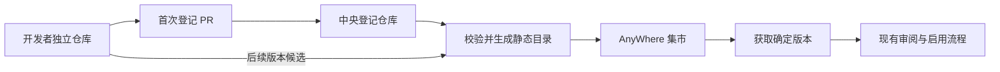

# 思源插件集市调研与 AnyWhere 适配建议

核验日期：2026-09-09（Asia/Shanghai）。只读查阅官方 README、GitHub Actions 和源码，未运行第三方插件，未执行安装或发布。以下“直接证据”指所列固定版本源码或官方说明；线上部署时延和客户端实际运行结果未做端到端验证。

AnyWhere 对照版本：`ba6629d990c2a02cc9e8c22cf81ef72232250fa2`。本报告不表示已实现中央集市或跨包工作流。

固定来源：

| 官方仓库 | 本次核验 commit |
|---|---|
| siyuan-note/bazaar | [63659cb2eaf4cf11d91d6ab95b33327b0587b0c5](https://github.com/siyuan-note/bazaar/tree/63659cb2eaf4cf11d91d6ab95b33327b0587b0c5) |
| siyuan-note/siyuan | [8641553a1f07374001902d3ce773285db1292b2d](https://github.com/siyuan-note/siyuan/tree/8641553a1f07374001902d3ce773285db1292b2d)，提交标注 Release v3.8.3 |
| siyuan-note/plugin-sample | [d9ad60b556585ab66acbb494fc5aae0be62b2f86](https://github.com/siyuan-note/plugin-sample/tree/d9ad60b556585ab66acbb494fc5aae0be62b2f86) |

## 1. 用户理解基本正确，但提交的是仓库登记

**直接证据：首次收录采用 Fork 中央仓库 → 修改列表 → PR → 自动检查及维护者审核 → 合并。常规版本更新无需再次 PR。** 插件源码与 `plugin.json` 保存在开发者自己的仓库；开发者自行构建 `package.zip`，上传自己的 GitHub Release。中央仓库负责登记、校验、生成索引及同步分发，不是汇集全部插件源码的单体仓库。[中央流程](https://github.com/siyuan-note/bazaar/blob/63659cb2eaf4cf11d91d6ab95b33327b0587b0c5/README.zh-CN.md#L15-L54)、[示例打包发行](https://github.com/siyuan-note/plugin-sample/blob/d9ad60b556585ab66acbb494fc5aae0be62b2f86/README.zh-CN.md#L207-L224)。

| 数据 | 所在位置、准确格式 | 谁维护 |
|---|---|---|
| 插件登记 | bazaar 根目录 `plugins.txt`，每行 `owner/repo` | 开发者通过 PR，中央维护者合并 |
| 完整插件元数据 | 开发者发行包根目录 `plugin.json` | 开发者 |
| 中央生成索引 | bazaar `stage/plugins.json`，顶层 `repos` 数组，每项包含 `url`、`repoRef`、`updated`、`stars`、`openIssues`、`size`、`installSize`、`package` | Stage 自动生成，不能手工提交修改 |
| 实际安装包 | 开发者 Release 的 `package.zip`；中央同步至官方对象存储 | 开发者构建，中央校验并镜像 |
| 弃用提示 | bazaar `deprecated.json`，按包类型和 `owner/repo` 登记 | 专门 PR，中央维护；弃用不等于禁止安装 |

索引的 `package` 是规范化后的清单。主要字段为 `name`、`author`、`url`、`version`、`minAppVersion`、`displayName`、`description`、`readme`、`icon`、`preview`、`keywords`、`funding`，以及插件的 `backends`、`frontends`、`kernels`、`disabledInPublish`、`bootAppearances`。[字段定义](https://github.com/siyuan-note/bazaar/blob/63659cb2eaf4cf11d91d6ab95b33327b0587b0c5/rules/manifest.go#L48-L103)、[stage 与公开索引结构](https://github.com/siyuan-note/bazaar/blob/63659cb2eaf4cf11d91d6ab95b33327b0587b0c5/actions/util/stage.go#L23-L74)。

**文档存在旧说明：** plugin-sample 的上架章节仍要求修改 `plugins.json` 的 `{ "repos": [...] }`。本次中央仓库实际使用 `plugins.txt`，README 和 PR CI 一致，应以中央实现为准。示例要求 `name` 等于仓库名；当前中央校验实际强调合法名称、跨类型不区分大小写唯一、上架后不变，未强制新包 `name == repo`。[旧示例说明](https://github.com/siyuan-note/plugin-sample/blob/d9ad60b556585ab66acbb494fc5aae0be62b2f86/README.zh-CN.md#L226-L238)、[当前名称校验](https://github.com/siyuan-note/bazaar/blob/63659cb2eaf4cf11d91d6ab95b33327b0587b0c5/rules/manifest.go#L324-L423)。

## 2. 开发者首次收录与后续更新

1. 使用官方示例开发；自行打包，发布一个含确切名称 `package.zip` 资产的 GitHub Latest Release。示例用 `pnpm run build`，中央不替作者执行插件的编译脚本。
2. 首次收录 Fork `siyuan-note/bazaar`，仅在 `plugins.txt` 增加一行 `owner/repo`，向 `main` 提 PR。单个新增 PR 只允许一个新包；维护者迁移、下架有各自约束。
3. PR Check 自动检查，维护者仍须审核并合并。检查通过不等于已经合并，也不能据此声称每个发行版本都经过完整安全审计。
4. 后续在自己的仓库提高清单语义化 `version`，发布新的 Latest Release 和 `package.zip`；中央定期拉取、校验并发布，**不需要每次改中央列表或再次提 PR**。维护者更换、下架、弃用等中央登记变化才走对应 PR 流程。[官方流程](https://github.com/siyuan-note/bazaar/blob/63659cb2eaf4cf11d91d6ab95b33327b0587b0c5/README.zh-CN.md#L15-L54)。

PR 的直接校验包括：改动文件范围及登记数量；仓库公开性和 LICENSE；Latest Release、`package.zip`、tag 可解析；ZIP 路径和包根；必需的 `README.md`、`plugin.json`、`index.js`；名称唯一性、URL、语义化版本、README 所指文件、平台及图片等清单规则。`index.css` 出现在示例打包清单中，但当前中央必需文件检查没有把它列为强制项。[PR 检查入口](https://github.com/siyuan-note/bazaar/blob/63659cb2eaf4cf11d91d6ab95b33327b0587b0c5/actions/check/main.go#L495-L573)、[校验流水线](https://github.com/siyuan-note/bazaar/blob/63659cb2eaf4cf11d91d6ab95b33327b0587b0c5/rules/run.go#L40-L50)、[必需文件](https://github.com/siyuan-note/bazaar/blob/63659cb2eaf4cf11d91d6ab95b33327b0587b0c5/rules/files.go#L29-L49)。

检查失败后在原 PR/包仓库修复。CI 约每 20 分钟按活跃度复检尚未通过的开放 PR，也支持维护者加 `Check` 标签或手动触发。Stage 的定时配置是每小时；中央 README 对外描述一般 1–3 小时，示例写每小时。应分别理解为“计划触发频率”和“通常可见延迟”，均不是实时更新承诺。[PR 工作流](https://github.com/siyuan-note/bazaar/blob/63659cb2eaf4cf11d91d6ab95b33327b0587b0c5/.github/workflows/pr-check.yml#L3-L47)、[Stage 工作流](https://github.com/siyuan-note/bazaar/blob/63659cb2eaf4cf11d91d6ab95b33327b0587b0c5/.github/workflows/stage.yml#L1-L41)。

## 3. 索引构建、同步与 CDN

当前公开构建服务就在 bazaar 自身：`.github/workflows/stage.yml` 运行 `actions/stage`，提交生成索引，再运行 `actions/index`。列表变动触发增量，定时/手动运行全量。

```text
plugins.txt 的 owner/repo
  → GitHub Latest Release → package.zip 资产
  → 解压与规则校验、版本检查、元数据提取
  → 七牛 OSS：package/owner/repo@包内容哈希
  → 写入并提交 stage/plugins.json
  → 七牛 OSS：bazaar@中央仓库commit/stage/plugins.json
  → 向 rhythm 上报中央仓库 commit，客户端据此寻找索引
```

这里有三个不同标识，不能混用：

- **包地址 `@hash`：当前取 `package.zip` SHA-256 的前 7 位，不是插件源码 Git commit。** Stage 先比较 Release asset ID；内容变化时再计算/获取 SHA-256 并校验。新 asset 内容完全相同会被报为空更新；版本不提升也会失败。常规更新失败保留该仓库旧索引，避免坏包替换已收录版本。
- `repoRef`：当前 Stage 写入 Release tag，供源码/README 关联等用途；不是安装包摘要。
- `bazaar@<hash>`：中央索引快照使用 bazaar 仓库完整 commit。

Stage 内部还保存 `packageZipAssetId`、完整 `packageZipSha256`，但 `ForPublicIndex()` **不把这两个字段发布给客户端**。因此不能将当前实现描述成“客户端按完整 SHA-256 校验安装包”或“源码与二进制可复现构建证明”。[Stage 更新逻辑](https://github.com/siyuan-note/bazaar/blob/63659cb2eaf4cf11d91d6ab95b33327b0587b0c5/actions/stage/main.go#L339-L480)、[包 hash 定义](https://github.com/siyuan-note/bazaar/blob/63659cb2eaf4cf11d91d6ab95b33327b0587b0c5/actions/util/package_hash.go#L19-L60)、[公开字段](https://github.com/siyuan-note/bazaar/blob/63659cb2eaf4cf11d91d6ab95b33327b0587b0c5/actions/util/stage.go#L27-L74)。

包及 README、清单、声明的图标/预览资源校验后上传 OSS；索引上传成功后，`actions/index` 才向 `https://rhythm.b3log.org/api/siyuan/bazaar/hash` POST 上报。七牛 SDK 配置启用 HTTPS/CDN；主仓库将 `https://oss.b3logfile.com` 标注为集市包全球 CDN。[包镜像](https://github.com/siyuan-note/bazaar/blob/63659cb2eaf4cf11d91d6ab95b33327b0587b0c5/actions/stage/index.go#L127-L215)、[索引发布和上报](https://github.com/siyuan-note/bazaar/blob/63659cb2eaf4cf11d91d6ab95b33327b0587b0c5/actions/index/main.go#L41-L106)、[OSS 上传](https://github.com/siyuan-note/bazaar/blob/63659cb2eaf4cf11d91d6ab95b33327b0587b0c5/actions/util/oss.go#L67-L105)、[客户端地址](https://github.com/siyuan-note/siyuan/blob/8641553a1f07374001902d3ce773285db1292b2d/kernel/util/cloud.go#L82-L84)。

## 4. 客户端获取、安装和更新

**直接源码链路：**

1. 内核请求所选云端 `/apis/siyuan/version?ver=...`，读取响应 `bazaar` 字段。`GetRhyBazaarHash` 提供中央索引 commit。
2. 下载 `https://oss.b3logfile.com/bazaar@<中央commit>/stage/plugins.json`。hash 变化会清理集市缓存；不是从 GitHub 搜索所有插件仓库。
3. 另有统计/评分索引：`https://bazaar.b3logfile.com/bazaar/index-v3.json`，失败回退 `index.json`。这与上述包目录索引用途不同。
4. 用户安装时，内核下载 `https://oss.b3logfile.com/package/<owner>/<repo>@<包hash>`，取得 ZIP；安装到 `<workspace>/data/plugins/<name>`。这条安装链路没有 `git clone`。
5. 下载后解析包清单，确认包名匹配；先写临时目录，再复制至安装目录同级 staging，旧目录改名为 backup，再切换新目录；切换失败尝试还原。
6. 更新列表按已装包 `name` 匹配线上清单，并用 semver 比较 `version`。当前 UI 的单包更新和全部更新都有确认操作；更新后重载原本已启用的插件。

来源：[云端 hash](https://github.com/siyuan-note/siyuan/blob/8641553a1f07374001902d3ce773285db1292b2d/kernel/util/rhy.go#L73-L126)、[包索引缓存与地址](https://github.com/siyuan-note/siyuan/blob/8641553a1f07374001902d3ce773285db1292b2d/kernel/bazaar/stage.go#L206-L250)、[统计索引](https://github.com/siyuan-note/siyuan/blob/8641553a1f07374001902d3ce773285db1292b2d/kernel/bazaar/index.go#L38-L44)、[ZIP 下载与安装](https://github.com/siyuan-note/siyuan/blob/8641553a1f07374001902d3ce773285db1292b2d/kernel/bazaar/install.go#L43-L70)、[替换与回退](https://github.com/siyuan-note/siyuan/blob/8641553a1f07374001902d3ce773285db1292b2d/kernel/bazaar/install.go#L130-L246)、[版本比较](https://github.com/siyuan-note/siyuan/blob/8641553a1f07374001902d3ce773285db1292b2d/kernel/model/bazaar.go#L229-L258)、[更新 UI](https://github.com/siyuan-note/siyuan/blob/8641553a1f07374001902d3ce773285db1292b2d/app/src/config/bazaar/events.ts#L200-L241)、[更新后重载](https://github.com/siyuan-note/siyuan/blob/8641553a1f07374001902d3ce773285db1292b2d/kernel/model/bazaar.go#L536-L562)。

**结论边界：中央自动收录新 Release ≠ 客户端静默自动安装。** 本次确认的是自动索引与用户触发安装/更新链路；未验证部署可见时间、实际下载成功、重启缓存行为或设备上的运行效果。

## 5. 插件加载、SDK 和权限边界

**前端直接证据：**内核读取 `data/plugins/<name>/index.js`、可选 CSS 与 i18n，通过 `/api/petal/loadPetals` 返回已启用、兼容的插件。前端 loader 使用 `window.eval` 加载 CommonJS 导出，要求插件类继承 `Plugin`，再创建实例。CSS 通过 `<style>` 插入宿主页面，没有按插件自动隔离选择器。[文件加载](https://github.com/siyuan-note/siyuan/blob/8641553a1f07374001902d3ce773285db1292b2d/kernel/model/plugin.go#L201-L298)、[JS 加载器](https://github.com/siyuan-note/siyuan/blob/8641553a1f07374001902d3ce773285db1292b2d/app/src/plugin/loader.ts#L32-L79)、[CSS 注入](https://github.com/siyuan-note/siyuan/blob/8641553a1f07374001902d3ce773285db1292b2d/app/src/plugin/loader.ts#L157-L175)。

官方 SDK 仓库是 `siyuan-note/petal`，本次固定 [0326b71262eff1c73d6d5e69e4421be42015729f](https://github.com/siyuan-note/petal/tree/0326b71262eff1c73d6d5e69e4421be42015729f)。npm 包 `siyuan` 提供类型声明；模板将其作为 external，运行时 `require("siyuan")` 由宿主映射到 API，包含 `Plugin`、菜单、对话框、设置、编辑器等接口。**SDK 和集市索引是不同组件。**[模板 external](https://github.com/siyuan-note/plugin-sample/blob/d9ad60b556585ab66acbb494fc5aae0be62b2f86/webpack.config.js#L68-L80)、[宿主 API 导出](https://github.com/siyuan-note/siyuan/blob/8641553a1f07374001902d3ce773285db1292b2d/app/src/plugin/API.ts#L396-L442)。

每个前端进程各持一份插件实例，正常调用 `onload` → 内核连接初始化 → `onLayoutReady`，之后有数据变化通知 `onDataChanged`。禁用/重载执行 `onunload`，移除插件才执行 `uninstall`。异步拆除共用 5 秒等待预算，不能取消超时 Promise 或中断同步 JS；关闭独立窗口、退出思源也不能依赖这些前端钩子一定运行。[官方生命周期说明](https://github.com/siyuan-note/plugin-sample/blob/d9ad60b556585ab66acbb494fc5aae0be62b2f86/README.zh-CN.md#L261-L278)。

**不能宣称前端插件有逐插件安全沙箱。**它在宿主 window 内执行、能访问 DOM；非 `siyuan` 的 require 回退 `window.require`。Electron 主窗口配置为 `nodeIntegration: true`、`contextIsolation: false`，桌面插件因此有 Node/Electron 能力入口；浏览器和移动端须按实际环境区分。官方要求 data 读写走内核 API、避免直接 `fs` 损坏同步数据，这是开发约定，不是禁止调用 fs 的权限机制。[Electron 配置](https://github.com/siyuan-note/siyuan/blob/8641553a1f07374001902d3ce773285db1292b2d/app/electron/main.js#L2033-L2040)、[官方文件规范](https://github.com/siyuan-note/plugin-sample/blob/d9ad60b556585ab66acbb494fc5aae0be62b2f86/README.zh-CN.md#L244-L248)。

当前版本另有 `kernel.js`：由 `plugin.json.kernels` 声明平台，在独立 Goja 运行时加载，并接受宿主注入的能力。它与前端加载不同，不能沿用“思源插件只有前端 JS”的旧结论；但独立运行时也不能直接等同于最小权限沙箱——插件内核 JWT 带管理员角色，`client.fetch` 调用本机内核时自动携带该 token。[内核运行时](https://github.com/siyuan-note/siyuan/blob/8641553a1f07374001902d3ce773285db1292b2d/kernel/plugin/plugin.go#L184-L215)、[插件 token](https://github.com/siyuan-note/siyuan/blob/8641553a1f07374001902d3ce773285db1292b2d/kernel/model/auth.go#L318-L329)、[请求能力](https://github.com/siyuan-note/siyuan/blob/8641553a1f07374001902d3ce773285db1292b2d/kernel/plugin/api_client.go#L119-L124)。

## 6. 集市不等于跨插件工作流

- **直接证据：**集市提供登记、发现、分发、更新；SDK 提供宿主扩展接口。当前还有以插件名称寻址的 JSON-RPC 路由，带认证/管理员/非只读检查；前端 `this.kernel.rpc` 默认连接自身同名内核插件。[RPC 路由](https://github.com/siyuan-note/siyuan/blob/8641553a1f07374001902d3ce773285db1292b2d/kernel/api/router.go#L678-L685)、[前端 RPC 地址](https://github.com/siyuan-note/siyuan/blob/8641553a1f07374001902d3ce773285db1292b2d/app/src/plugin/kernel.ts#L132-L160)。
- **推断：**插件可通过内核接口向目标插件已暴露的 RPC 发起调用；这是可用于协作的通信基础，本次没有运行验证。
- **未确认：**在所查集市、加载器、SDK 和示例中，没有找到足以证明“通用跨插件工作流定义、步骤编排、依赖及数据流执行契约”的直接证据。不能从中央集市或 RPC 推导出这项能力，也不应绝对声称思源无法让插件协作。

**AnyWhere 可借鉴的是职责分离：**中央列表审核准入，开发者仓库拥有源码与发行，自动任务产生静态目录和明确版本的分发对象，客户端自行安装与更新。固定源码 commit、安装包摘要、用户可见版本应区分；运行时权限、SDK、跨插件调用及工作流契约仍需按 AnyWhere 自身需求设计。这里是架构推论，未在本调研修改或验证 AnyWhere 生产实现。

## 7. AnyWhere 已有的基础

以下均已核对当前本地源码：

| 环节 | 当前实现 | 建议复用或补齐 |
| --- | --- | --- |
| 社区发现 | GitHub 搜索 `topic:anywhere-pack`，按 stars 取一页 50 项 | 集市页改读受维护的静态目录；URL 导入继续保留 |
| 包结构 | 根目录 `manifest.json`，包含动作、UI 和同包工作流 | 沿用扩展包作为唯一安装单元，不再另造一套插件格式 |
| 安装 | 克隆默认分支，解析清单、审阅文件，再确认安装和启用 | 中央目录提供确定来源与版本引用；仍走已有审阅流程 |
| 更新 | `ls-remote HEAD` 比较提交，再克隆并审阅差异 | 集市安装改为比较目录发布的确定 revision；直接 URL 导入可保持原行为 |
| 页面运行 | 独立 WKWebView、宿主注入 SDK、受约束 Bridge、受管理脚本任务 | 保持现有 Swift/WKWebView 结构，集市不要求更换运行时 |
| 跨包串联 | 尚未实现；步骤只在本 manifest 中查 action | 沿用既有跨包设计，另补公开入口、契约和调度；集市不能替代这部分 |

源码入口：[PackDiscovery](../../App/Managers/PackDiscovery.swift)、[PackManager](../../App/Managers/PackManager.swift)、[PackManifest](../../Core/Sources/AnyWhereCore/PackManifest.swift)、[PluginSession](../../App/Plugins/PluginSession.swift)、[跨包设计](../cross-pack-workflows.zh.md)。

## 8. 推荐的最小落地方式

以下是 AnyWhere 建议方案，尚未实现。

1. 建一个独立中央登记仓库，例如暂名 `appdev/anywhere-bazaar`；开发者源码仍在各自仓库。本次没有创建此仓库。
2. 登记文件只维护稳定目录 ID 与仓库来源；展示名称、介绍、动作类型等尽量从既有 manifest 生成，避免开发者在两处重复维护。
3. 开发者首次通过 fork → 修改登记文件 → PR 申请收录。CI 检查 ID/来源冲突、manifest 合法性、路径及文件大小、必需资源；不执行提交者的脚本。维护者审阅后合并。
4. 合并与定时任务生成静态 `catalog.json`，客户端通过 HTTPS 获取并缓存。服务不可用时使用上次有效目录，现有已安装包仍可使用。
5. 初版可以继续复用 Git 安装，目录记录完整 commit SHA，安装时明确获取该提交；不能展示某个已校验版本却实际安装不断变化的 HEAD。检查更新成功只意味着发现候选版本，不自动执行或启用它。
6. 后续若 Git 依赖、速度或大仓库体积成为实际问题，再增加 Release ZIP 与制品哈希验证；无需第一版就自建对象存储、CDN、开发者账号后台和付费系统。



首次收录审核与每次版本内容审核需要区分：仓库获收录不代表未来所有代码都已人工审查。自动更新目录时仍须执行静态检查，并保留用户当前的版本差异审阅。来源转移、包 ID 冲突、撤下记录由中央目录治理；不把本地来源派生的 `packKey` 直接当作未来跨包调用的全局 ID，也不自动搬迁旧配置和数据。

## 9. 与跨开发者工作流的关系

中央集市负责「找到、收录、分发和更新工具」。跨包工作流负责「按入口身份调用工具并传递结果」。两者可以共享包身份、来源和版本信息，但不能相互替代。

第三方工作流包将来同样可登记在集市里，并声明依赖甲、乙、丙的公开工具入口。用户应能在安装前看清依赖与数据流向；运行时仍由 AnyWhere 按各目标包身份解析、授权和调用，而不是让工作流包读取其他包的私有文件或聚合它们的权限。当前尚不支持纯工作流包，这属于[跨包实施计划](../cross-pack-workflows.zh.md)的范围。

建议先做中央目录与现有安装器对接；稳定包身份同时为后续跨包调度留出明确映射。不要为了集市先重写 UI SDK，也不要把上架 PR 当作插件隔离或跨工具调用的实现。
